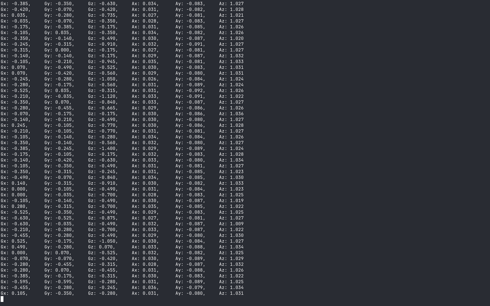

# LSM6DSOX

SPI driver for the LSM6DSOX IMU on a Raspberry Pi Pico 2. It prints gyro (dps) and accel (g) readings over USB serial once per second.

#


## Wiring

| IMU | Pico 2 |
|-----|--------|
| SDO/MISO | GP16 |
| CS | GP17 |
| SCK | GP18 |
| SDI/MOSI | GP19 |
| VCC / GND | 3V3 / GND |

## Build and flash

1. Open the folder in VS Code with the Raspberry Pi Pico extension and click **Compile**.
2. Hold **BOOTSEL**, plug in the Pico, and copy `build/LSM6DSOX.uf2` onto the drive that appears.

## View output (115200 baud)

**Mac**

```
ls /dev/cu.usbmodem*
screen /dev/cu.usbmodem<number> 115200
```

Exit with Ctrl-A, then K, then Y.

**Windows (WSL)**

```
usbipd list
usbipd attach --wsl --busid <BUSID>
sudo minicom -D /dev/ttyACM0 -b 115200
```

Exit with Ctrl-A, then X.

**Windows (no WSL)**

Open the Pico's COM port (see Device Manager) in PuTTY or Tera Term at 115200 baud.

## Expected output

`WHO_AM_I : 6c` followed by live `Gx/Gy/Gz/Ax/Ay/Az` readings. If WHO_AM_I isn't `6c`, check the wiring.
